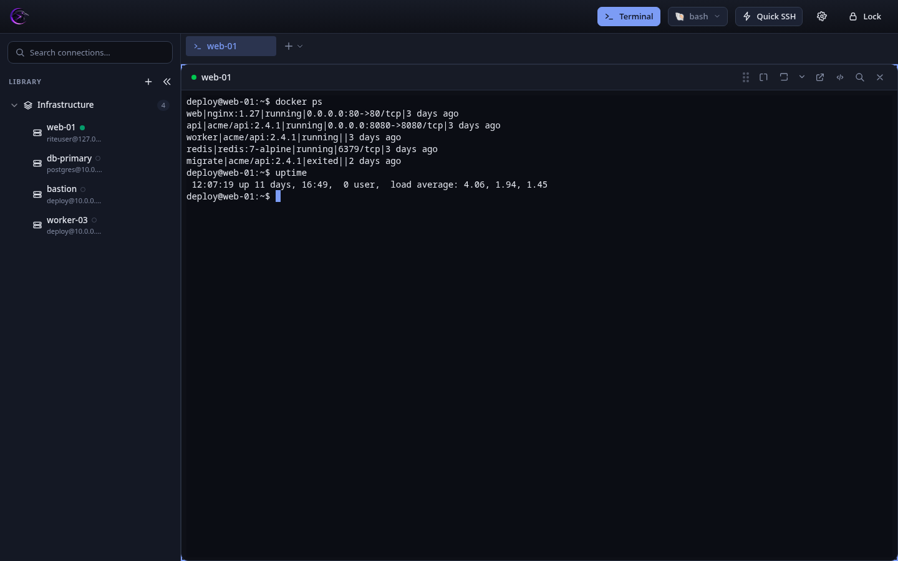
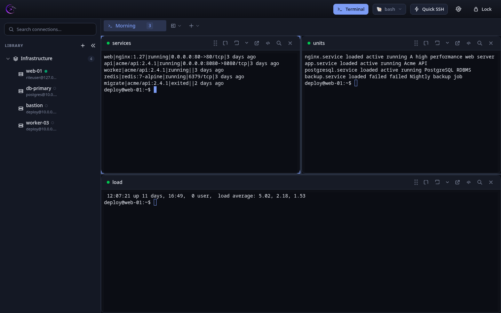
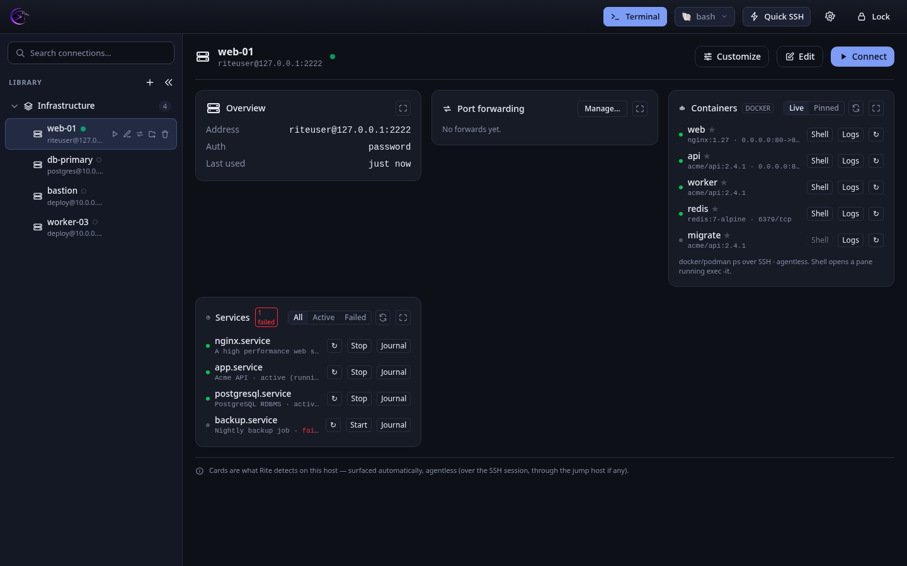
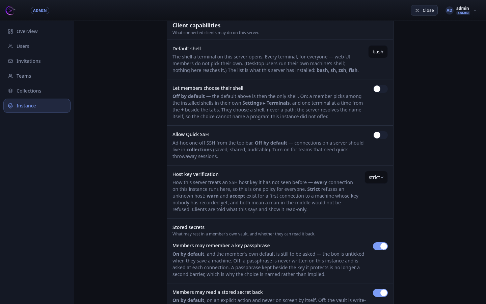

<div align="center">
  

  <h1>RITE</h1>

  <p>Rust &amp; TypeScript Interface for Terminal Environment</p>

  <p>
    <a href="https://github.com/Altagen/Rite/actions/workflows/ci.yml"></a>
    <a href="https://github.com/Altagen/Rite/releases/latest"></a>
    <a href="LICENSE-MIT"></a>
  </p>
</div>

An SSH client for a fleet: sessions, saved machines, and the policies a team needs
around them. One Rust core behind two shells — a desktop window and a web UI served by
the same binary.

---

## Interface

The same React bundle runs in both shells, so these are the desktop window too. Taken by
driving the real UI (`e2e/tests/screenshots.spec.ts`), against seeded data — regenerate
them with `RITE_SHOTS=1 npx playwright test --project=shots`.

| | |
|---|---|
| **The workspace** — the library on the left, a session on the right. Tabs, split panes, and the shell picker beside **Terminal**. | **Layouts** — what opens in the morning, declared in a file on the machine: panes, which machine each one is on, and the command it runs. |
|  |  |
| **The machine dashboard** — containers, services and port forwards, read over the SSH session. No agent is installed on the host. | **Administration** — what an instance governs for everyone: the shell its terminals open, host-key verification, and what may rest in a member's vault. |
|  |  |

---

## Features

**Sessions**

- SSH over [russh](https://github.com/Eugeny/russh) with xterm.js, in tabs and split panes
- **Layouts** — a TOML file on the machine declares what opens where, on which host, running what
- **Jump hosts** (ProxyJump, chainable), **port forwarding**, and a **pre-connect hook** per machine
- **Machine dashboard** — containers, services and forwards, read agentlessly over the session

**Secrets**

- Argon2id KDF, ChaCha20-Poly1305 AEAD, zeroized memory; the vault is encrypted at rest
- **Zero-knowledge on a shared server** — the client encrypts; the server stores ciphertext and
  decrypts nothing
- Password, key file, a key carried in the vault, or an SSH **agent** (desktop, nothing stored)

**Teams**

- Accounts, roles and teams; **collections** of machines shared with a role each
- An **admin console** for what the instance governs: shells, Quick SSH, host-key policy,
  and whether a member may keep a passphrase or read a stored secret back
- **Instance as code** — those policies declared in a TOML file; the console shows what it
  cannot change and names where it was declared

See the [Roadmap](docs/ROADMAP.md) for what is planned.

---

## Tech Stack

- **Core**: Rust (`rite-core`) — one UI-agnostic library behind every shell
- **Shells**: `rite-server` (Axum HTTP/WS) + a wry desktop client that embeds it
- **Frontend**: React + TypeScript + TailwindCSS (served over HTTP/WS)
- **Terminal**: xterm.js
- **Database**: SQLite (encrypted)
- **Crypto**: Argon2id, ChaCha20-Poly1305, age
- **SSH**: russh (pure Rust)
- **Package Manager**: pnpm (monorepo)
- **Build System**: Task (go-task)

## Platform Support

| Platform | Status |
|----------|--------|
| Linux x86_64 | ✅ Primary target |
| Linux ARM64 | ✅ Supported |
| macOS Intel | ✅ Supported |
| macOS Apple Silicon | ✅ Supported |
| Windows | ❌ Not planned |

---

## Getting Started

### Prerequisites

Three toolchains, each pinned in the repo so a local build and CI are the same build.
Install the manager, not the version — it reads the pin:

- **Rust** — [rustup](https://rustup.rs/); the version comes from `rust-toolchain.toml`
- **Node.js** — [fnm](https://github.com/Schniz/fnm) or nvm; the version comes from `.node-version`
- **pnpm** — `corepack enable`; the version comes from `packageManager` in `package.json`
- **Task** — [go-task](https://taskfile.dev/installation/)

Installing pnpm by hand is what these pins exist to prevent: an older pnpm rewrites
`pnpm-lock.yaml` on install and silently drops the security overrides declared in
`pnpm-workspace.yaml`. Let corepack pick it.

### Development Setup

```bash
git clone https://github.com/Altagen/Rite.git
cd Rite
pnpm install
task dev
```

`task dev` runs the native wry client (rite-server in-process + webview).
`task dev:server` runs rite-server standalone, and `task dev:frontend` runs the
Vite dev server against the mock backend.

### Before Pushing

Run the full CI check suite locally before every push:

```bash
task check
```

This runs in order: `cargo fmt --check`, `clippy`, `cargo test`, both dependency audits
(`scripts/audit.sh`, which fails when a check could not run rather than reporting what it
managed to ask) and `tsc`. Same checks as CI — if it passes locally, it passes on the remote.

### Building for Production

```bash
task build
```

See [RELEASE.md](docs/RELEASE.md) for the release process.

---

## Configuration

### User Data Directories

- **Linux**: Config `~/.config/rite/`, Data `~/.local/share/rite/`
- **macOS**: Config & Data `~/Library/Application Support/rite/`

### Files

| Path | Purpose |
|------|---------|
| `~/.config/rite/layouts.toml` | The workspace file: presets and layouts ([Layouts](docs/LAYOUTS.md)) |
| `~/.local/share/rite/vault.db` | Encrypted vault: machines, collections, secrets |
| `~/.local/share/rite/device.json` | This machine's UI preferences |
| `~/.local/share/rite/vaults.json` | The vaults this client knows about |

---

## Project Structure

```
rite/
├── apps/
│   └── desktop/          # Desktop client
│       ├── shell/        # wry native shell (binary `rite`, embeds rite-server)
│       └── src/          # React frontend (served over HTTP/WS)
├── packages/
│   ├── rite-core/        # UI-agnostic core: auth, connections, terminals (Rust)
│   ├── rite-server/      # Axum HTTP/WS server + embedded frontend (Rust)
│   └── crypto/           # Cryptography module (Rust)
├── e2e/                  # Playwright end-to-end suite + standalone checks
├── scripts/
│   └── install.sh        # Installs the client; the binary emits, this places
├── Containerfile.server  # Production rite-server image
├── docs/
│   ├── ARCHITECTURE.md
│   ├── LAYOUTS.md
│   ├── RELEASE.md
│   ├── ROADMAP.md
│   ├── SECURITY.md
│   └── SERVER.md
├── Cargo.toml            # Rust workspace
├── pnpm-workspace.yaml
└── Taskfile.yaml
```

---

## Documentation

- [Install](INSTALL.md) — Running a release: the client binary, the server image, where state lives
- [Quick start](QUICKSTART.md) — A working checkout and the commands that matter
- [Architecture](docs/ARCHITECTURE.md) — Technical architecture
- [Server](docs/SERVER.md) — Running an instance for a team: TLS, the container, policies as code
- [Layouts](docs/LAYOUTS.md) — The workspace file: presets and layouts
- [Security](docs/SECURITY.md) — Security policy and practices
- [Roadmap](docs/ROADMAP.md) — Feature roadmap
- [Release](docs/RELEASE.md) — Release process and conventional commits

---

## Contributing

Issues and bug reports are welcome on [GitHub](https://github.com/Altagen/Rite/issues).

For security vulnerabilities, please **do not** open a public issue. See [SECURITY.md](./docs/SECURITY.md).

## License

RITE is dual-licensed under:
- MIT License — see [LICENSE-MIT](./LICENSE-MIT)
- Apache License 2.0 — see [LICENSE-APACHE](./LICENSE-APACHE)

You may choose either license for your use.
